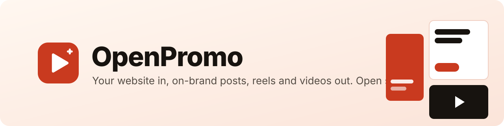

<p align="center">
  <a href="https://openpromo.gg"></a>
</p>

<p align="center">
  <a href="LICENSE"></a>
  <a href="#-self-host-with-docker"></a>
  <a href="https://openpromo.gg/docs/mcp"></a>
  <a href="https://openpromo.gg"></a>
</p>

<p align="center">
  
  
  
  
  
  
</p>

<h3 align="center">
  <a href="https://openpromo.gg">Website</a>
  &nbsp;·&nbsp;
  <a href="https://openpromo.gg/docs">Docs</a>
  &nbsp;·&nbsp;
  <a href="https://openpromo.gg/docs/self-hosting">Self-hosting</a>
  &nbsp;·&nbsp;
  <a href="https://openpromo.gg/docs/mcp">Connect an agent</a>
  &nbsp;·&nbsp;
  <a href="https://openpromo.gg/docs/rest-api">REST API</a>
</h3>

<br>

**OpenPromo** ([openpromo.gg](https://openpromo.gg)) turns your website into social posts, carousels, reels, promo videos and tutorials. Add your site and OpenPromo reads it into a brand profile: what you sell, who for, how you sound, your colours, fonts, logo and products. Every image and video is made from that profile, in your own fonts and colours, saying only what your site says.

Open source and self-hostable. Bring your own [YepAPI](https://yepapi.com?ref=openpromo) key: OpenPromo charges nothing, every call is listed with its cost, and a monthly limit stops spending before it crosses the line you set.

⭐ **If OpenPromo is useful to you, a star helps other people find it.**

> [!NOTE]
> OpenPromo is early and in active development. [Issues](https://github.com/duckduckdeploy/openpromo/issues) and ideas are very welcome.

## ✨ Why OpenPromo

- 🧠 **It knows your business first.** One read of your website gives every tool the same brief: your selling points (each with the sentence and page it came from), audience, voice, colours, fonts, logo, products and getting-started steps. You edit it once; edits survive the next read.
- ✅ **No made-up claims.** Before anything renders, checks flag figures that are not on your site, hype words, text that is too long to read in time, a missing hook or a missing call to action.
- 🔤 **Real text, never garbled.** Words are set as real text in your brand's fonts. AI models only make what they are good at: backdrop photos, B-roll, voiceover and music.
- 🔓 **Open source, all of it.** The app, the API, the renderer and the agent server are MIT licensed.
- 💸 **No surprise bills.** Pay YepAPI per use with your own key. Generated pieces are kept, so re-rendering after an edit only pays for what is new.
- 🤖 **Agents included.** 18 MCP tools, a REST API and a Claude plugin with ready-made skills.

## 🧰 What you can make

<table>
  <tr>
    <th width="24%" align="left">Tool</th>
    <th align="left">What you get</th>
  </tr>
  <tr>
    <td>🎨 Brand profile</td>
    <td>Read from your site with headless Chrome: identity, audience, selling points with source quotes, voice, colours (including your logo's), fonts, logo, products, getting-started flows, screenshots of every page read</td>
  </tr>
  <tr>
    <td>💡 Post ideas</td>
    <td>Specific ideas by goal and channel, each with a hook, a ready caption and hashtags, citing the selling points it uses; one click makes it</td>
  </tr>
  <tr>
    <td>🖼️ Images</td>
    <td>Instagram and LinkedIn posts (1:1, 4:5), stories (9:16), ad and link banners (1.91:1), X and LinkedIn headers; carousels as PNG slides plus a PDF</td>
  </tr>
  <tr>
    <td>🎬 Reels</td>
    <td>9:16 videos for Reels, TikTok and Shorts: a hook in the first two seconds, voiceover, a music bed, word-by-word captions in seven styles (kept clear of the app buttons), a thumbnail and an SRT file</td>
  </tr>
  <tr>
    <td>📽️ Promo videos</td>
    <td>16:9, 1:1 or 9:16 videos that explain what you do: problem, solution, features shown with your own screenshots and products, proof, call to action</td>
  </tr>
  <tr>
    <td>🧭 Tutorials</td>
    <td>Getting-started walkthroughs, one narrated step per scene, from your product's own screens</td>
  </tr>
  <tr>
    <td>🗂️ Library</td>
    <td>Every file in one place: site screenshots and photos, uploads, AI pictures, voice, music and finished media</td>
  </tr>
</table>

Scenes come in ten layouts (hero, statement, big number, list, quote, screenshot in a device frame, product, picture and text, offer, call to action) and three looks (clean, bold, photo). One scene renders in any size; text shrinks until it fits, and colour pairs that would be hard to read are fixed.

## 🐳 Self-host with Docker

You need [Docker](https://docs.docker.com/get-docker/). Rendering video runs Chrome and FFmpeg, so give it at least 2 CPUs and 4 GB of memory.

```bash
git clone https://github.com/duckduckdeploy/openpromo.git openpromo
cd openpromo
cp .env.example .env
# In .env, set AUTH_SECRET (32+ random characters)
# and ENCRYPTION_KEY (openssl rand -base64 32)
docker compose up -d --build
```

| Service | Address |
|---|---|
| Dashboard | http://localhost:3200 |
| Site and docs | http://localhost:3101 |
| API and MCP | http://localhost:4100 (`/api/*`, `/mcp`) |

One image runs everything: Postgres, the API with its MCP server, background worker and renderer (Chrome, FFmpeg and fonts included), the dashboard and the site. Database migrations run when the API starts; media files live in a Docker volume.

**On a cloud server with your own domain**, add HTTPS with automatic Let's Encrypt certificates:

1. Point your domain, `app.` and `api.` at the server.
2. Set `OPENPROMO_DOMAIN`, `APP_URL`, `WEB_URL`, `PUBLIC_API_URL` and `POSTGRES_PASSWORD` in `.env`.
3. Run `docker compose --profile https up -d --build`.

The [self-hosting guide](https://openpromo.gg/docs/self-hosting) covers servers, updates, backups and every setting.

## 🤖 Connect your AI agent

The MCP server gives agents the whole workflow as 18 tools: read and edit the brand, write ideas, write and edit creations, render, and fetch the files. Paid tools say what they cost.

**ChatGPT and Claude (web and desktop):** add a custom connector with the URL `{API_URL}/mcp` and OAuth sign-in. You sign in with your OpenPromo account and approve; no key needed.

For other agents, create an API key under Settings and store it in an environment variable named `OPENPROMO_API_KEY`. **The quick way:** copy the setup prompt from Settings and paste it into your agent; it connects itself and checks the connection with free calls only.

**Claude Code:** install the plugin, which bundles the connection and the skills:

```bash
/plugin install openpromo --marketplace duckduckdeploy/openpromo
```

Set `OPENPROMO_MCP_URL` to point it at a self-hosted install.

### 🧩 Skills

| Skill | What it does |
|---|---|
| [`brand-check`](plugins/openpromo/skills/brand-check/SKILL.md) | Read your website and tidy up the brand profile every tool builds from |
| [`content-plan`](plugins/openpromo/skills/content-plan/SKILL.md) | A month of post ideas from your selling points, with captions |
| [`social-posts`](plugins/openpromo/skills/social-posts/SKILL.md) | On-brand images and carousels for Instagram, LinkedIn and ads |
| [`promo-reel`](plugins/openpromo/skills/promo-reel/SKILL.md) | A short vertical video with voiceover and captions for Reels, TikTok and Shorts |
| [`tutorial-video`](plugins/openpromo/skills/tutorial-video/SKILL.md) | A getting-started walkthrough of your product, narrated |

## 💳 What it costs

The software is free. Generation runs on your own [YepAPI](https://yepapi.com?ref=openpromo) key, at YepAPI's prices:

| Step | Typical cost |
|---|---|
| Reading a website into a brand profile | $0.05–0.15 |
| A batch of post ideas, or writing one creation | $0.02–0.08 |
| Rendering images and carousels | $0, plus $0.04–0.20 per AI picture if a scene asks for one |
| A 30-second reel | about $0.15–0.50 (voiceover about $0.01 a scene, music $0.08), plus AI pictures or clips if used |

## 🛠️ Development

Requirements: Node 26+, pnpm 10, Postgres 15+ (or `docker compose up -d postgres`, which listens on port 5434).

```bash
pnpm install
pnpm db:migrate
pnpm dev                 # API :4100, dashboard :3200, site :3101, with live reload
pnpm typecheck
pnpm test
```

Chrome comes with Puppeteer and FFmpeg with `ffmpeg-static`, so there is nothing else to install. The tests need no database, network or API keys: `apps/api/test` runs the real API against an in-memory Postgres (PGlite) with the real migrations and a stand-in for YepAPI (`apps/api/src/testing/fake-yepapi.ts`) that answers in YepAPI's shapes and makes real image, audio and video files. The brand and render tests drive real headless Chrome and render a real MP4. For local work without a key, run `pnpm --filter @openpromo/api fake-yepapi` and set `YEPAPI_BASE_URL=http://localhost:4199`.

`apps/api/scripts/preview-templates.ts` renders every layout in every size for a sample brand, to check template changes by eye.

```
apps/api          Fastify API, MCP server, background worker (pg-boss), website reader, renderer
apps/app          Dashboard (Next.js)
apps/web          Public site and docs (Next.js)
packages/render   Scene layouts, the video composition, captions and pre-render checks
packages/yepapi   Typed YepAPI client: chat, scraping, media jobs, price estimates
packages/shared   Brand profile, creation spec, formats and colour helpers
plugins/openpromo Claude plugin: MCP connection and skills
```

## 🔐 Security

- Stored YepAPI keys are encrypted at rest with AES-256-GCM (`ENCRYPTION_KEY`) and never returned by the API. API keys are stored as SHA-256 hashes and shown once.
- OAuth for MCP clients: dynamic client registration and PKCE (S256), exact redirect URIs, single-use codes, one-hour access tokens, rotating refresh tokens stored as hashes.
- The website reader refuses private, loopback and metadata addresses for every request a page makes, including redirects and sub-resources.
- Paid calls are not retried after a server error or a lost connection, since they may already have been billed. A spending limit refuses any call whose estimated price would cross it.
- In Docker, the app, site and API listen only on the machine itself. The optional Caddy service is the only thing facing the internet.

## 🙏 Built on

[Hyperframes](https://github.com/heygen-com/hyperframes) (Apache-2.0) renders HTML compositions to video. [Puppeteer](https://pptr.dev), [FFmpeg](https://ffmpeg.org), [sharp](https://sharp.pixelplumbing.com) and [GSAP](https://gsap.com) do the rest.

## 🤝 Contributing

Clear [issues](https://github.com/duckduckdeploy/openpromo/issues) are the most useful contribution: what you did, what you expected and what happened. For code, run `pnpm typecheck` and `pnpm test` before opening a pull request.

## 📄 Licence

[MIT](LICENSE). Use it, change it, host it.

<p align="center"><sub>Made in the open · <a href="https://openpromo.gg">openpromo.gg</a> · <a href="https://github.com/duckduckdeploy/openpromo">⭐ Star on GitHub</a></sub></p>
